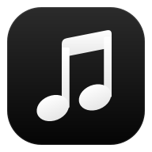
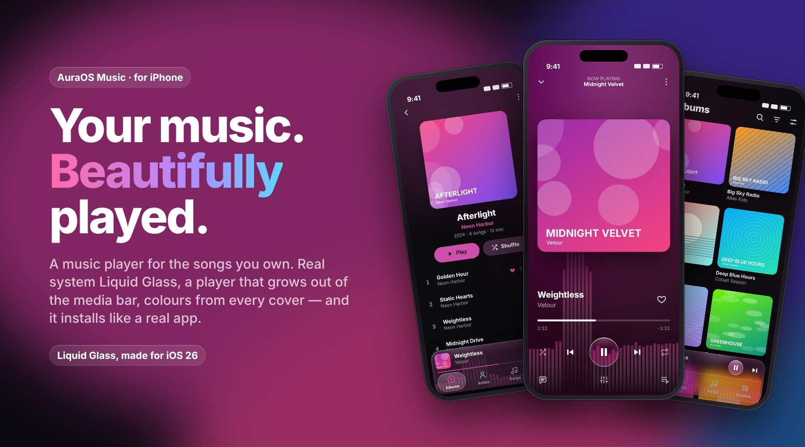
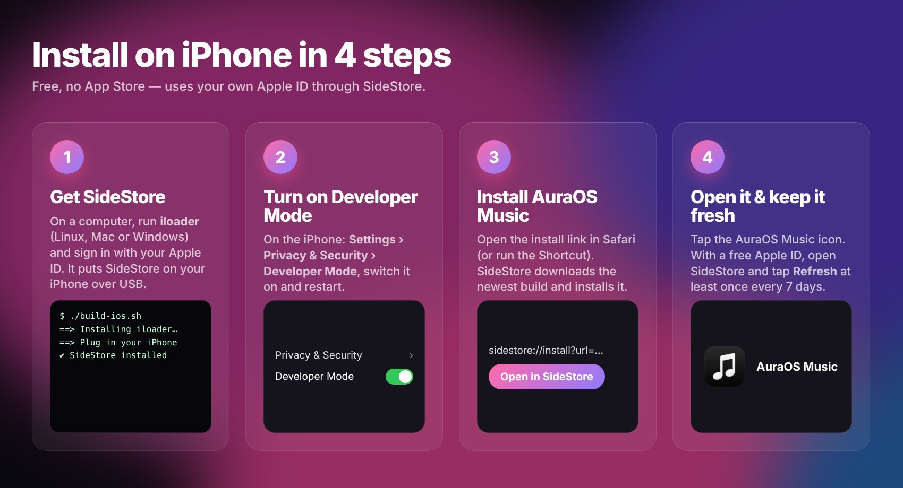
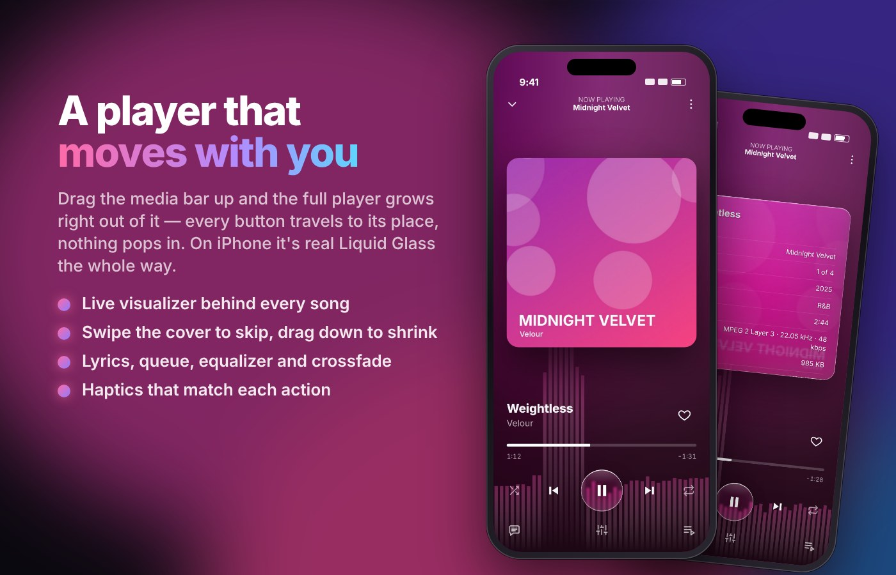
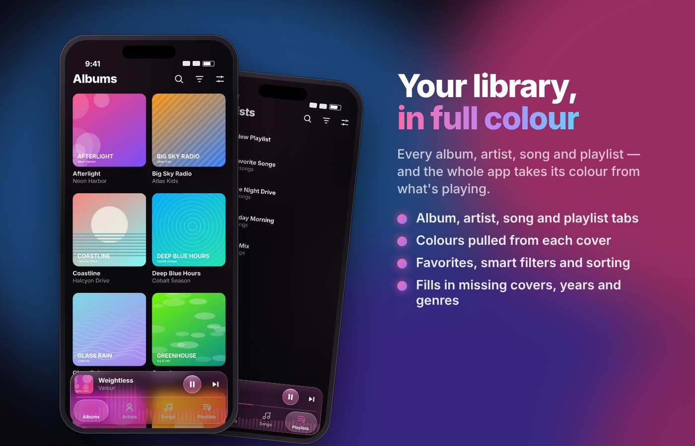
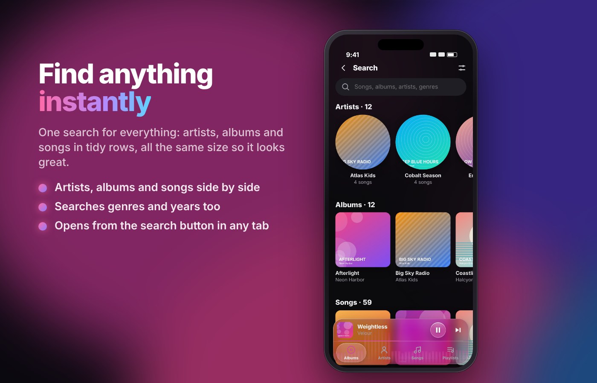
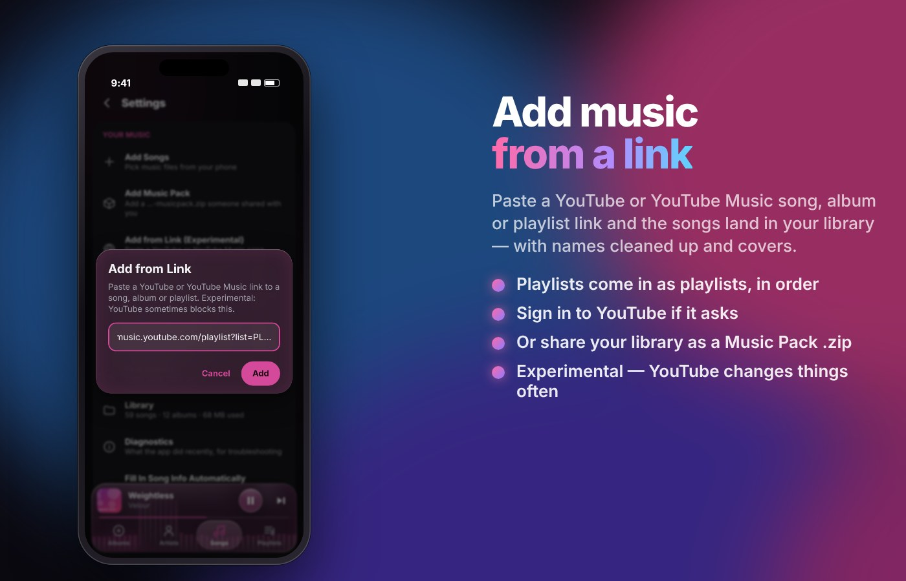
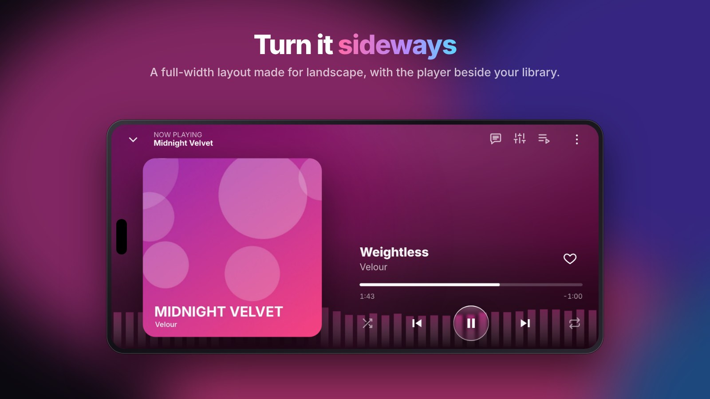

<div align="center">



# AuraOS Music for iPhone

**A music player for the songs you own, in real Liquid Glass for iOS 26.**

[**How to install**](#install-in-4-steps)
&nbsp;·&nbsp; [⬇ Latest .ipa](https://github.com/100kbrazy-a11y/auraos-music-ios/releases/latest/download/AuraOS-Music.ipa)
&nbsp;·&nbsp; [Features](#features)
&nbsp;·&nbsp; [Android version](https://github.com/100kbrazy-a11y/auraos-music-android)



</div>

## Install in 4 steps

No App Store and no paid developer account: **SideStore** installs the app with your own Apple ID, like a real app.



1. **Get SideStore on your iPhone (one time).** On a computer (Linux, Mac or Windows) run
   [**iloader**](https://github.com/nab138/iloader), plug in your iPhone, sign in with your Apple ID and install
   SideStore. On Fedora, `./build-ios.sh` (below) installs iloader for you.
2. **Turn on Developer Mode.** On the iPhone: **Settings › Privacy & Security › Developer Mode**, switch it on,
   restart and confirm.
3. **Install AuraOS Music.** On the iPhone, open this link in Safari (or put it in a Shortcut's **Open URLs** action):

   ```
   sidestore://install?url=https://github.com/100kbrazy-a11y/auraos-music-ios/releases/latest/download/AuraOS-Music.ipa
   ```

   SideStore downloads the newest build and installs it.
4. **Open it and keep it fresh.** With a free Apple ID, apps last 7 days. Open SideStore and tap **Refresh** at
   least once a week. Your library is kept.

**Updating:** open the same link again (or run the Shortcut). The new build installs over the old one and your
music, playlists and settings stay.

<details>
<summary><b>Trouble installing?</b></summary>

- **"Developer error 7252" / certificate errors in SideStore:** in SideStore go to Settings, sign out, sign back
  in, then try again. Re-run iloader if it keeps happening.
- **Sign-in error -80045 in SideStore:** Apple turned the sign-in down. Wait a little and try again, and check
  that you can sign in to the same Apple ID at appleid.apple.com.
- **"Untrusted developer":** Settings › General › VPN & Device Management › trust your Apple ID.
- **App won't open after a week:** refresh it in SideStore (free Apple IDs expire apps after 7 days).

</details>

## Features



- **Real Liquid Glass.** The media bar, tabs, top bar, buttons, menus and Settings are Apple's own iOS 26 glass,
  tinted with the song's colour. The media bar grows into the full player in real glass, with every button
  travelling to its place and nothing popping in.
- **Clear glass lens:** touch and slide the tabs (or the top-bar buttons) and a clear lens rides along,
  magnifying what's under it.
- **Live visualizer**, a bass glow, **swipe the cover** to skip, **tap it** to flip it over for scrollable song
  details, and drag down to shrink.
- **Lyrics** (synced, from LRCLIB), queue, 10-band **equalizer**, **crossfade** up to 12 seconds.
- **Haptics everywhere** through the Taptic Engine.
- **Keeps playing in the background** and with the screen locked, with lock-screen and Control Center controls.



- **Albums, Artists, Songs and Playlists**, with colours from every cover used consistently across the app.
- **Filters, sorting, favorites, multi-select**, and lookup of missing covers, years and genres.
- Songs are stored as real files inside the app, so big libraries and packs work. Covers that didn't save
  during an import are repaired automatically.



- **Search** from the button on any tab: artists, albums and songs in tidy rows of same-size cards.
- The search pill shrinks and grows smoothly as you go in and out of Search.



- **Add Songs** and **Add Music Pack** open Apple's Files browser (packs start in Downloads).
- **Add from Link (experimental):** paste a YouTube or YouTube Music song, album or playlist link. Sign in under
  **Settings › YouTube Account** if YouTube asks. YouTube fights downloaders, so this can stop working. If it
  fails, **Settings › Diagnostics › Copy** shows why. Only add music you have the right to.
- **Music Packs** you export are saved in Files › On My iPhone › AuraOS Music and work with the Android app too.



- **Landscape:** a full-width layout with a floating tab pill and a media bubble that can tuck into a cover.

<sub>Screenshots use a demo library of made-up artists with generated artwork. They're taken from the app's web
view, so the glass in them is an approximation of the real system glass you see on an iPhone.</sub>

## Build it yourself (Fedora / Linux)

```bash
cd ~/Downloads && rm -rf auraos-music-ios && unzip -o auraos-music-ios.zip && cd auraos-music-ios && ./build-ios.sh
```

What it does:

1. Installs anything missing: Node.js, git, the GitHub CLI, iPhone USB support (usbmuxd, libimobiledevice) and qrencode.
2. Checks that the app builds.
3. Puts the project in this repo on your GitHub. Apple only allows iPhone apps to be compiled on a Mac, so
   GitHub's free Mac machines build it (`.github/workflows/ios.yml`, about 5–10 minutes).
4. Downloads **AuraOS-Music.ipa** to your Downloads folder.
5. Installs **iloader** for putting SideStore on your iPhone (one time only).
6. Prints a QR code and the install link, and saves **AuraOS-Music-iPhone-setup.txt** in Downloads.

If the build sits at "build (ID …)" for a while, it's waiting in line for a free Mac at GitHub; it starts on its own.

## How the glass works

The floating parts are native iPhone views using Apple's Liquid Glass (`ios-native/NativeChrome.swift`, added to
the Xcode project by `scripts/patch-ios.mjs`):

- the media bar and tabs (upright) and the tab pill and media bubble (sideways), with the same gestures as the
  web version: tap to open, swipe sideways to skip, drag up to grow the player, slide the tab highlight, and tucking
- play/pause is a system glass button tinted with the song's colour, and the glass is shaped with
  `cornerConfiguration`, as iOS 26 expects
- the top bar's buttons are glass, and once you scroll a full-width glass bar with the title fades in
- Settings is a real iOS screen with the system back button and edge swipe, native switches, a crossfade slider and an EQ menu
- song menus, confirmations and rename boxes are the system's glass menus and alerts

The web screens underneath still decide sizes and positions. On iOS before 26 the same views use the frosted blur.

## Files

- `src/`: the app, shared with the [Android version](https://github.com/100kbrazy-a11y/auraos-music-android).
- `ios/`: the Xcode project (Capacitor). `scripts/patch-ios.mjs` adds background audio, Files access and the native code.
- `ios-native/NativeChrome.swift`: the native glass, background player and YouTube check page.
- `.github/workflows/ios.yml`: the build on GitHub. `build-ios.sh`: the one command above.
