<div align="center">

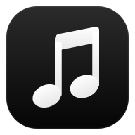

# Strata Music for iPhone

**A music player for the songs you own, in real Liquid Glass for iOS 26.**

[**How to install**](#install-on-your-iphone)
&nbsp;·&nbsp; [⬇ Latest .ipa](https://github.com/100kbrazy-a11y/auraos-music-ios/releases/latest/download/Strata-Music.ipa)
&nbsp;·&nbsp; [Features](#features)
&nbsp;·&nbsp; [Android version](https://github.com/100kbrazy-a11y/auraos-music-android)

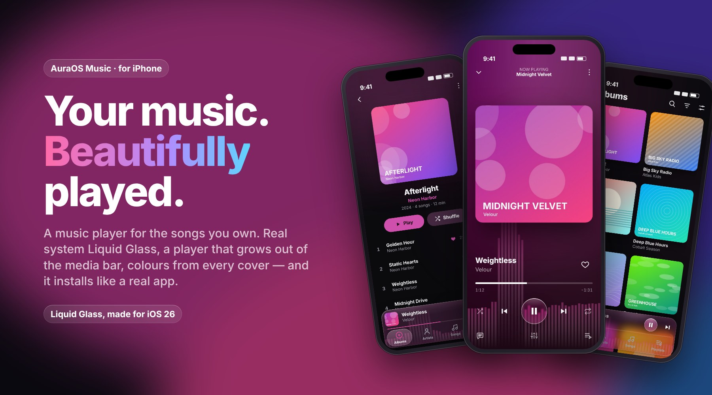

</div>

## Install on your iPhone

No App Store listing and no paid developer account. **SideStore** installs the app with your own free Apple ID, and
you can set the whole thing up **on the iPhone itself, with no computer**, using SideInstaller.

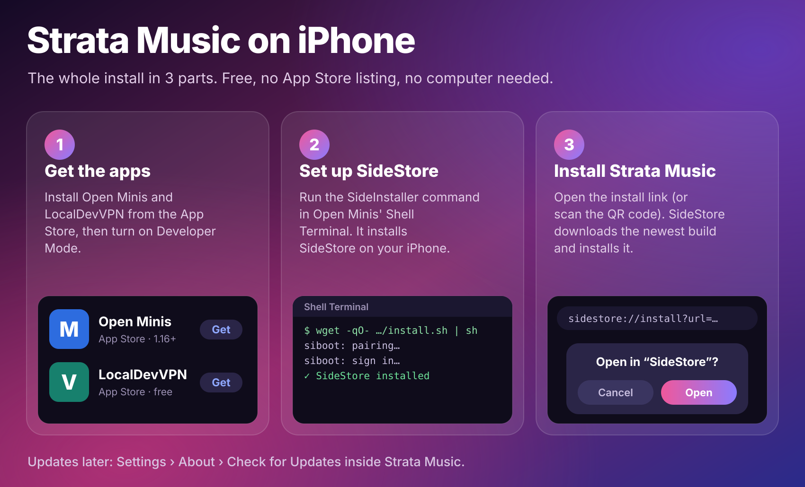

> The pictures in this guide are **illustrations** of each step, not screenshots. Screens in Open Minis, SideStore
> and iOS can look a little different on your phone and change between versions.

**What you need**

| | |
|---|---|
| iPhone | **iOS 27 or newer** for the on-device method below (older iOS: see [Using a computer instead](#using-a-computer-instead)) |
| Internet | Wi-Fi, for the setup |
| Apple ID | A free one is fine. It signs the apps for your own iPhone |
| Apps (free, App Store) | **Open Minis** (version 1.16 or newer) and **LocalDevVPN** |

### Part 1: Get the apps

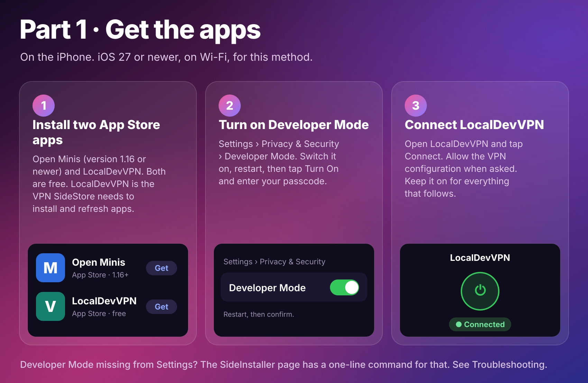

1. Install **Open Minis** and **LocalDevVPN** from the App Store.
2. Turn on **Developer Mode**: **Settings › Privacy & Security › Developer Mode**, switch it on, let the iPhone
   restart, then tap **Turn On** and enter your passcode. If Developer Mode isn't in Settings yet, see
   [Troubleshooting](#troubleshooting).
3. Open **LocalDevVPN** and tap **Connect**. Allow the VPN configuration when iOS asks. **Keep it connected**
   whenever you install, update or refresh an app. SideStore uses it to talk to your own iPhone.

### Part 2: Set up SideStore

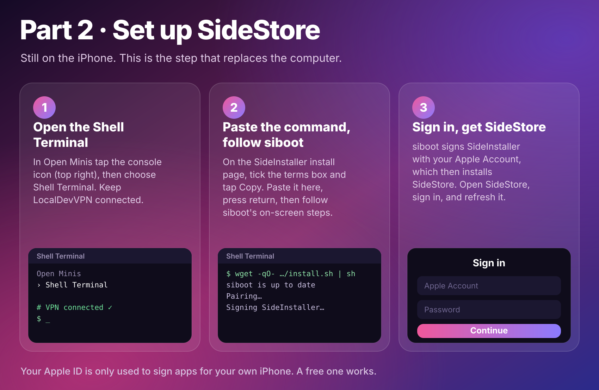

1. In **Open Minis**, tap the **console icon** (top right) and choose **Shell Terminal**. Keep LocalDevVPN connected.
2. Open the SideInstaller page, [**sideinstaller.net/install.html**](https://sideinstaller.net/install.html), tick
   the terms box and tap **Copy** on the command. Paste it into the terminal and press return. (It's their command,
   so copy it from their page and it stays current.)
3. Follow the **siboot** instructions that appear on screen. siboot signs SideInstaller with your Apple Account,
   which then installs **SideStore**.
4. Open **SideStore** and sign in with your Apple ID. If iOS asks, trust the profile in
   **Settings › General › VPN & Device Management**.

> **Good to know:** SideInstaller, Open Minis and siboot are made by other people, not by this project. The command
> downloads and runs a script from their GitHub repo, and siboot handles your Apple Account sign-in. Only continue
> if you're comfortable with that, and read their page first. If you'd rather not, use
> [a computer instead](#using-a-computer-instead).

### Part 3: Install Strata Music

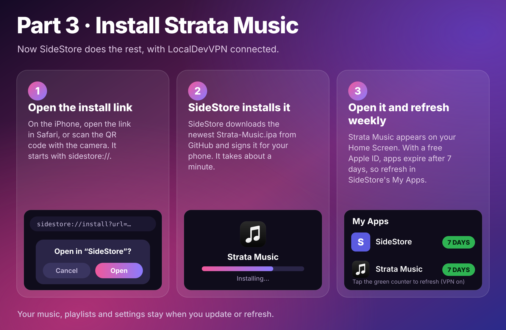

With LocalDevVPN connected, open this link on the iPhone (in Safari, or scan the QR code below with the camera, or
put it in a Shortcut's **Open URLs** action):

```
sidestore://install?url=https://github.com/100kbrazy-a11y/auraos-music-ios/releases/latest/download/Strata-Music.ipa
```

SideStore downloads the newest build and installs it. It takes about a minute, then Strata Music is on your Home
Screen.

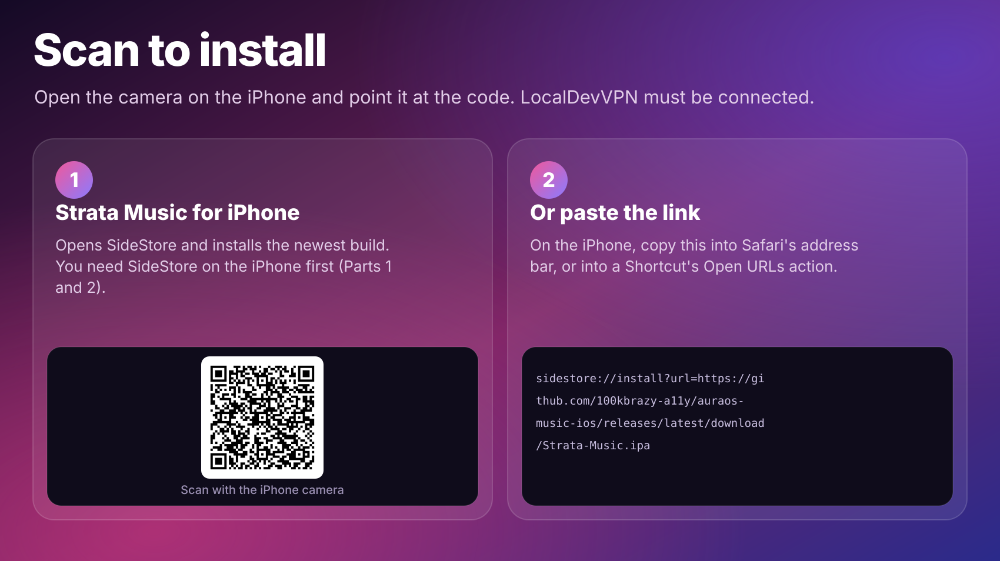

## Keeping it fresh

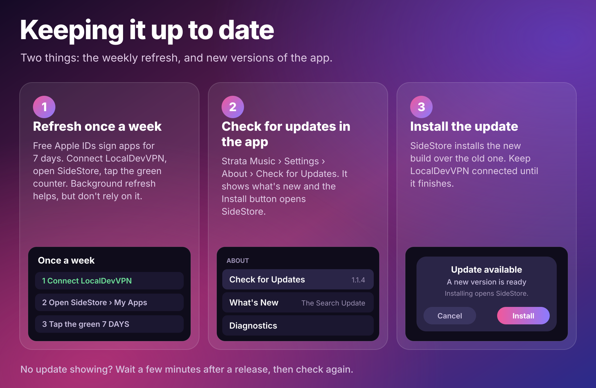

- **Refresh weekly.** A free Apple ID signs apps for **7 days**. Connect LocalDevVPN, open SideStore and tap the
  green **7 DAYS** counter in **My Apps**. SideStore can also refresh in the background, but don't count on it.
- **Free account limits:** 3 active apps at a time, and 10 new App IDs per 7 days.
- **Updating Strata Music:** in the app go to **Settings › About › Check for Updates** (version 1.1 and newer). It
  shows what's new, and **Install** opens SideStore to do the update. Or just open the install link again.
  Your music, playlists and settings stay.

## Troubleshooting

<details>
<summary><b>Developer Mode isn't in Settings</b></summary>

On some phones the switch doesn't appear until something has been sideloaded. The SideInstaller page has a one-line variant of the
command that turns it on (it adds `-s developer-mode`). Use the exact command shown there.
</details>

<details>
<summary><b>Install or refresh does nothing, or fails</b></summary>

Open **LocalDevVPN** and make sure it says **Connected**, then try again. It has to stay on for the whole install
or refresh.
</details>

<details>
<summary><b>Sign-in error -80045 in SideStore</b></summary>

Apple's sign-in was turned down. Wait a bit and retry, and check you can sign in to the same Apple ID at
appleid.apple.com. In SideStore settings you can also try turning off **On-Device Anisette**, picking the
**SideStore (New)** server, and turning off **Auto Rotation**, or use SideStore's Nightly build.
</details>

<details>
<summary><b>"Developer error 7252" / certificate errors</b></summary>

In SideStore go to Settings, sign out, sign back in, then try again.
</details>

<details>
<summary><b>"Untrusted developer"</b></summary>

**Settings › General › VPN & Device Management**, then trust your Apple ID.
</details>

<details>
<summary><b>The app won't open after a week</b></summary>

It expired. Connect LocalDevVPN and refresh it in SideStore. Your library is kept.
</details>

<details>
<summary><b>"Check for Updates" says I'm up to date but there's a new build</b></summary>

Wait a few minutes after a release (the build takes a while), then check again.
</details>

### Using a computer instead

On iOS below 27, or if you'd rather not run a terminal command on the phone: on a computer (Linux, Mac or Windows)
run [**iloader**](https://github.com/nab138/iloader), plug in your iPhone, sign in with your Apple ID and install
SideStore. Then turn on Developer Mode, connect LocalDevVPN and continue from
[Part 3](#part-3-install-strata-music). On Fedora, `./build-ios.sh` (below) installs iloader for you.


## Features

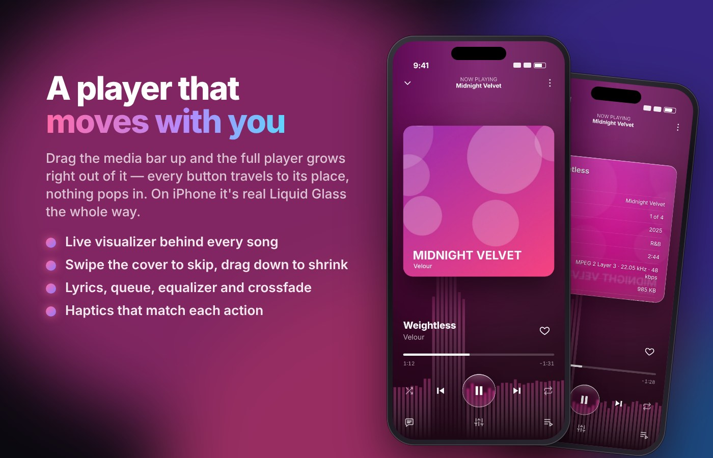

- **Real Liquid Glass.** The media bar, tabs, top bar, buttons, menus and Settings are Apple's own iOS 26 glass,
  tinted with the song's colour. The media bar grows into the full player in real glass, with every button
  travelling to its place and nothing popping in.
- **Clear glass lens:** touch and slide the tabs (or the top-bar buttons) and a clear lens rides along,
  magnifying what's under it.
- **Live visualizer**, a bass glow, **swipe the cover** to skip, **tap it** to flip it over for scrollable song
  details, and drag down to shrink.
- **Lyrics** (synced, from LRCLIB), queue, 10-band **equalizer**, **crossfade** up to 12 seconds.
- **Haptics everywhere** through the Taptic Engine.
- **Keeps playing in the background** and with the screen locked, with lock-screen and Control Center controls.

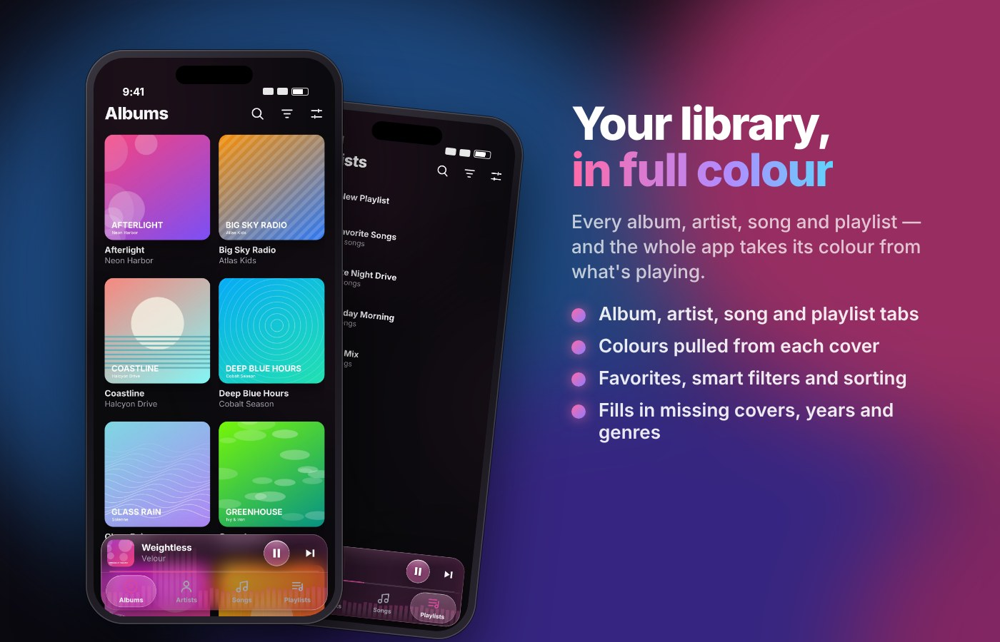

- **Albums, Artists, Songs and Playlists**, with colours from every cover used consistently across the app.
- **Filters, sorting, favorites, multi-select**, and lookup of missing covers, years and genres.
- Songs are stored as real files inside the app, so big libraries and packs work. Covers that didn't save
  during an import are repaired automatically.

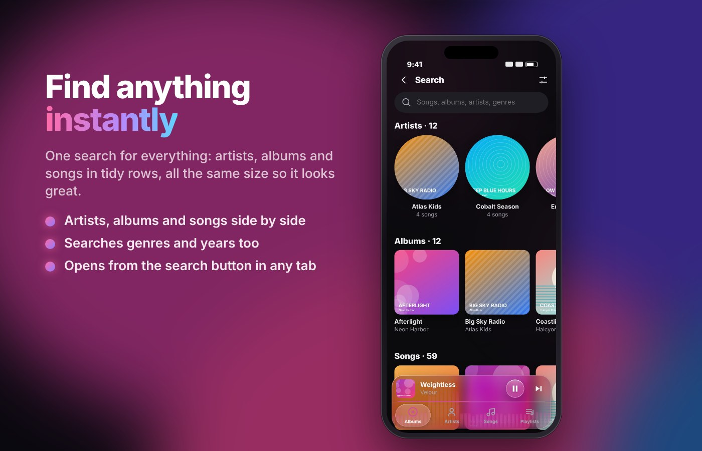

- **Search** from the button on any tab: artists, albums and songs in tidy rows of same-size cards.
- The search pill shrinks and grows smoothly as you go in and out of Search.

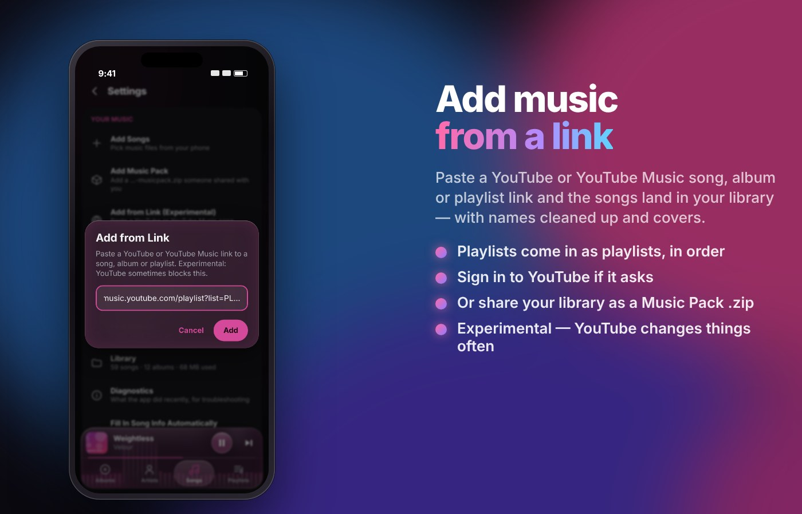

- **Add Songs** and **Add Music Pack** open Apple's Files browser (packs start in Downloads).
- **Add from Link (experimental):** paste a YouTube or YouTube Music song, album or playlist link. Sign in under
  **Settings › YouTube Account** if YouTube asks. YouTube fights downloaders, so this can stop working. If it
  fails, **Settings › Diagnostics › Copy** shows why. Only add music you have the right to.
- **Music Packs** you export are saved in Files › On My iPhone › Strata Music and work with the Android app too.

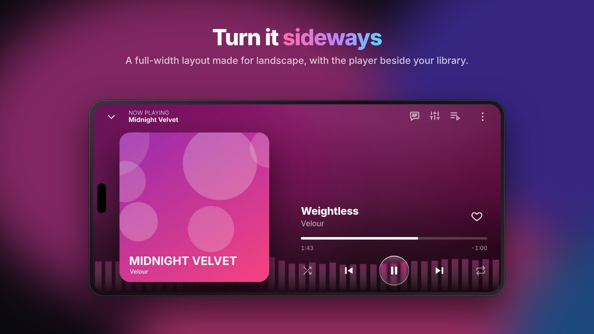

- **Landscape:** a full-width layout with a floating tab pill and a media bubble that can tuck into a cover.

<sub>Screenshots use a demo library of made-up artists with generated artwork. They're taken from the app's web
view, so the glass in them is an approximation of the real system glass you see on an iPhone.</sub>

## Build it yourself (Fedora / Linux)

```bash
cd ~/Downloads && rm -rf auraos-music-ios && unzip -o auraos-music-ios.zip && cd auraos-music-ios && ./build-ios.sh
```

What it does:

1. Installs anything missing: Node.js, git, the GitHub CLI, iPhone USB support (usbmuxd, libimobiledevice) and qrencode.
2. Checks that the app builds.
3. Puts the project in this repo on your GitHub. Apple only allows iPhone apps to be compiled on a Mac, so
   GitHub's free Mac machines build it (`.github/workflows/ios.yml`, about 5–10 minutes).
4. Downloads **Strata-Music.ipa** to your Downloads folder.
5. Installs **iloader** for putting SideStore on your iPhone (one time only).
6. Prints a QR code and the install link, and saves **Strata-Music-iPhone-setup.txt** in Downloads.

If the build sits at "build (ID …)" for a while, it's waiting in line for a free Mac at GitHub; it starts on its own.

## How the glass works

The floating parts are native iPhone views using Apple's Liquid Glass (`ios-native/NativeChrome.swift`, added to
the Xcode project by `scripts/patch-ios.mjs`):

- the media bar and tabs (upright) and the tab pill and media bubble (sideways), with the same gestures as the
  web version: tap to open, swipe sideways to skip, drag up to grow the player, slide the tab highlight, and tucking
- play/pause is a system glass button tinted with the song's colour, and the glass is shaped with
  `cornerConfiguration`, as iOS 26 expects
- the top bar's buttons are glass, and once you scroll a full-width glass bar with the title fades in
- Settings is a real iOS screen with the system back button and edge swipe, native switches, a crossfade slider and an EQ menu
- song menus, confirmations and rename boxes are the system's glass menus and alerts

The web screens underneath still decide sizes and positions. On iOS before 26 the same views use the frosted blur.

## Files

- `src/`: the app, shared with the [Android version](https://github.com/100kbrazy-a11y/auraos-music-android).
- `ios/`: the Xcode project (Capacitor). `scripts/patch-ios.mjs` adds background audio, Files access and the native code.
- `ios-native/NativeChrome.swift`: the native glass, background player and YouTube check page.
- `.github/workflows/ios.yml`: the build on GitHub. `build-ios.sh`: the one command above.
